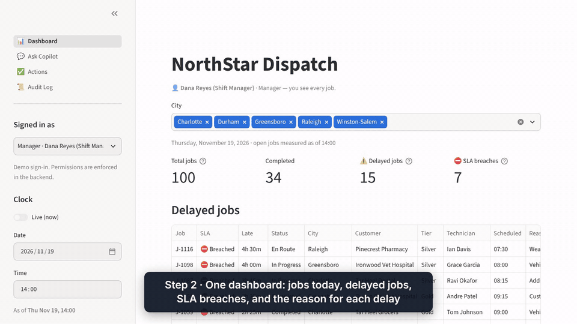
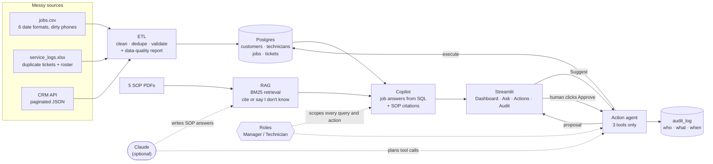

# dispatch-copilot

[](https://github.com/Akashrao0417/dispatch-copilot/actions/workflows/ci.yml)

A dispatcher copilot for **NorthStar Logistics** — messy real business data in, clear action out.



**Live demo:** [dispatch-copilot-0u7q.onrender.com](https://dispatch-copilot-0u7q.onrender.com) _(free tier: first load can take ~1 min while it wakes up)_ · **Demo video:** [docs/demo.mp4](docs/demo.mp4) · **Case study:** [docs/case_study.md](docs/case_study.md) · **Evals:** [docs/evals.md](docs/evals.md)

| | |
|---|---|
| Eval accuracy (30 questions) | **70% → 100%** after fixing the worst failures · **90%** on 10 held-out questions |
| "I don't know" when the SOPs don't cover it | 7/7 on the main set |
| Actions without a human Approve | **0** — every action is proposed, approved, then logged |
| Tests | **32 test functions → 75 test cases** (parametrized), run in CI on every push |

## Architecture



## The company

NorthStar Logistics is a regional delivery and field-service company in North Carolina
(Charlotte, Raleigh, Durham, Greensboro, Winston-Salem).

| | |
|---|---|
| **Drivers / technicians** | 120 field staff — drivers, installers and repair techs, each with a home city |
| **Jobs** | ~200 deliveries, installs, repairs, pickups and inspections across a few days; each has a 2-hour arrival window |
| **Customers** | 80 business customers on Gold / Silver / Bronze contracts (SLA 2h / 4h / 6h past the scheduled time) |
| **Tickets** | service notes drivers log against a job — "stuck on I-77", "part missing", "customer not home" |

### The problem

Every morning dispatchers are lost. The data lives in three systems that don't talk:

| Source | What's in it | What's wrong with it |
|---|---|---|
| `data/raw/jobs.csv` | the job board, exported from the dispatch tool | 6 different date formats, a `TBD` date, phones missing or written 6 different ways, cities as `CLT` / `charlotte ` / `Charlotte, NC`, tech IDs as `T014` / `t-14`, duplicate rows, a job for a customer that doesn't exist |
| `data/raw/service_logs.xlsx` | ops keeps service tickets and the technician roster in Excel | duplicate tickets (exact copies and re-typed ones in CAPS), duplicate roster rows |
| CRM API (`backend/crm_api.py`) | customer profiles and contract tier | paginated, nested JSON, some customers have no phone |

So jobs slip, nobody knows which ones are late or why, and customers keep calling.

## What's built

### Phase 1 — Data in
1. **Three messy sources** — generated by `data/generate_data.py` (200 jobs + injected mess).
2. **ETL into Postgres** — `backend/etl.py` cleans, dedupes and loads `customers`, `technicians`,
   `jobs`, `tickets`, and writes [`docs/data_quality_report.md`](docs/data_quality_report.md):
   rows dropped (and why), dates fixed, duplicates removed, phones backfilled.
3. **Dashboard** — total jobs today, delayed jobs, SLA breaches, jobs per technician, with the
   reason for each delay pulled from the service logs.

### Phase 2 — AI that answers
4. **Five 1-page SOP PDFs** in [`docs/sops/`](docs/sops/): Late Delivery (SOP-LD), Refunds (SOP-RF),
   Reassignment (SOP-RA), Safety Check (SOP-SC), Customer Updates (SOP-CU). Every section is
   numbered (`SOP-RA §3`) so answers can cite it exactly.
5. **RAG with citations** — `backend/rag.py` reads the PDFs, splits them by section, retrieves with
   BM25 and answers **only** from what it retrieved, citing `[SOP-XX §N]` with file and page.
   If retrieval is weak, or the model's answer doesn't cite a retrieved section, it answers
   **"I don't know"**. With `ANTHROPIC_API_KEY` set, Claude writes the answer; without a key, the
   copilot quotes the matching section (fully offline, deterministic).
6. **Job questions** — "Which jobs are late in Charlotte today, and why?" is answered from Postgres,
   not by the model, so every number matches the dashboard. Each job comes with its proof
   (job ID, ticket ID, reason) plus what the SOP says to do next.

### Phase 3 — AI that acts
7. **Roles** — `backend/auth.py`. **Manager** sees every job and can use all tools.
   **Technician** sees only their own jobs and can only create tickets on them. Enforced in the
   backend on every query and action, not just hidden in the UI.
   **Sign-in has two modes** (`AUTH_MODE`):
   - `demo` (the public live site): a one-click role picker with **no passwords**, so anyone can try
     both roles — and anyone can pick Manager. Fine for fictional data, not for real data.
   - `password`: real sign-in with salted PBKDF2-SHA256 hashes (Python standard library,
     constant-time comparison). Set passwords with `python -m backend.set_password manager`.
8. **Action agent with exactly 3 tools** — `backend/agent.py`:
   `reassign_technician`, `create_ticket`, `draft_customer_update`.
   The planner (Claude tool use, or SOP rules without a key) **proposes**; nothing changes until a
   person clicks **Approve**. At approval, permissions and rules are checked again
   (e.g. the new technician must be in the same city and still free, max 2 reassignments per job).
9. **Audit log** — every proposal, approval, rejection, execution and refused attempt is written to
   `audit_log` with **who, what, when**. The app tables are never dropped by the ETL.

### Definitions

- **Delayed** — not cancelled, and not finished by the end of its 2-hour arrival window.
- **SLA breach** — not cancelled, and not finished by the customer's tier deadline
  (Gold 2h, Silver 4h, Bronze 6h after the scheduled time).
- Open jobs are measured against the "as of" time (live clock by default; adjustable in the sidebar).

## Run it

Requires Python 3.12+ and Postgres (Docker is easiest). Dependencies are pinned to the exact versions CI tests.

```bash
pip install -r requirements.txt
docker compose up -d                          # Postgres on :5432 (user/pass postgres, db dispatch)

python data/generate_data.py                  # writes data/raw/*  ("today" = now)
python docs/sops/build_sops.py                # (re)builds the 5 SOP PDFs from docs/sops/sops.json
uvicorn backend.crm_api:app --port 8001 &     # fake CRM API
python -m backend.etl                         # clean + load + report + users/audit tables
streamlit run frontend/app.py                 # http://localhost:8501
pytest                                        # 75 test cases from 32 test functions (DB tests use throwaway databases)
python -m evals.run_evals --label run         # 30-question eval: accuracy, citations, latency, cost
```

Optional: `export ANTHROPIC_API_KEY=...` to let Claude write SOP answers and plan actions
(`CLAUDE_MODEL` picks the model). Everything works without it.

**Demo:** pick *Manager* in the sidebar → **Ask Copilot** → "Which jobs are late in Charlotte
today, and why?" → **Actions** → *Suggest actions* → approve a suggested reassignment
→ **Audit Log**. Then pick a technician and see only their jobs.

**Real sign-in:** `AUTH_MODE=password streamlit run frontend/app.py` after setting passwords with
`python -m backend.set_password <username>`.

**With Docker:** `docker compose --profile app up --build` → http://localhost:8501 (Postgres + app; demo data
is seeded automatically on first start).

## Deploy (Render)

1. Push this repo to GitHub.
2. Render dashboard → **New → Blueprint** → pick the repo. `render.yaml` creates a free Postgres and the
   Docker web service, and wires `DATABASE_URL`.
3. On start, `backend/bootstrap.py` seeds a fresh demo day if the data is from an earlier day.

Free tier notes: the web service sleeps after 15 min idle (about a minute to wake) and free Postgres
expires after 30 days; a new database is re-seeded automatically. The live site runs `AUTH_MODE=demo`
(no passwords) — only fictional data should ever be loaded into a public deploy.

Config via env vars (see `.env.example`): `DATABASE_URL`, `CRM_API_URL`, `AUTH_MODE`, `ANTHROPIC_API_KEY`,
`CLAUDE_MODEL`.

## Repo layout

```
data/        generator + raw messy sources
backend/     CRM API · ETL · schema · auth (roles) · queries · rag · copilot · agent · llm
frontend/    Streamlit: app.py (navigation) + views/ (dashboard, ask, actions, audit)
docs/        data quality report · data dictionary · sops/ (5 PDFs + source)
tests/       test_etl.py · test_copilot.py (RAG, roles, agent, audit) · test_auth_and_routing.py
             (passwords, permission matrix, router, startup) · test_evals.py (regression guard)
.github/     CI: tests + evals against Postgres on every push
evals/       30 questions + 10 held-out, runner, results
Dockerfile · docker-compose.yml · render.yaml
```
